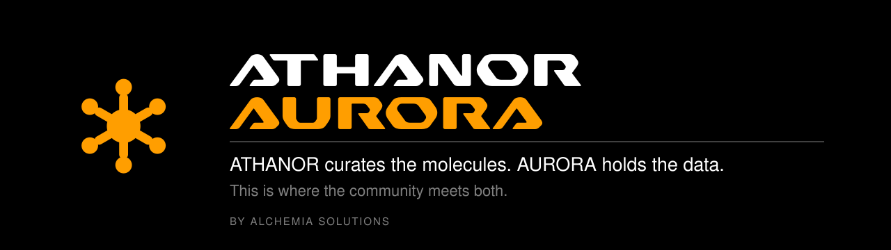
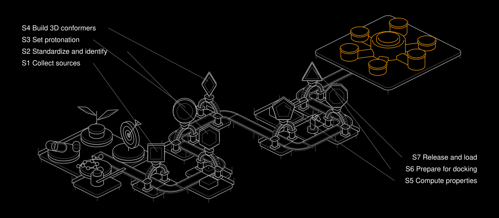

<div align="center">



<br>

<!-- numbers:begin badges -->
[](LICENSE)
[-FF9E00?style=for-the-badge&labelColor=000000)](CITATION.cff)
[](#at-a-glance)
[](docs/SOURCES.md)
<!-- numbers:end badges -->

**ATHANOR curates the data. AURORA is the database it produces.**

[](https://aurora.alchemia.solutions/home)
[](https://aurora.alchemia.solutions/dashboard)
[](https://aurora.alchemia.solutions/collections)
[-808080?style=for-the-badge&labelColor=000000)](https://aurora.alchemia.solutions/explorer)
[](https://aurora.alchemia.solutions/collaborate)
[](https://aurora.alchemia.solutions/docs)

The platform is a closed beta, and the v1.3 release has been live since 2026-10-26. Home, Dashboard, the
Collections pages, Collaborate and Documents are open to read, and the Explorer and the downloads need an
approved account. Every link above is listed in
[`data/site-links.json`](data/site-links.json), the one place to check when the release changes.

[What it is](#what-it-is) · [The pipeline](#the-athanor-pipeline) · [At a glance](#at-a-glance) · [Collections](#the-five-collections) · [Sources](docs/SOURCES.md) · [Docs index](docs/README.md) · [Read the API](#read-aurora-through-the-api) · [Limits](#honest-limitations) · [Cite](#citing) · [Contribute](#contributing)

</div>

---

## What it is

**AURORA** (Alchemia Unified Repository for Open Research Applications) is a molecular database for
computer-aided drug design, built and maintained by [ALCHEMIA SOLUTIONS](https://alchemia.solutions)
(legal entity Alchemia LTDA, Barretos, São Paulo, Brazil). ALCHEMIA is a Brazilian company that builds drug
design and discovery tools with AI, aimed at new cures. Its main package is licensed under CC BY-SA 4.0
and a companion package, AURORA-NC, under CC BY-NC 4.0. No package is published yet.

"Open" in the name refers to data under an open licence, the two packages each with its own licence. It
does not mean free access to everything, and it does not mean open source.

This repository describes the database: a standardized structure with a permanent identifier, a
protonation state at physiological pH, a 3D conformer, a docking file, computed descriptors,
fingerprints, ADMET predictions and the provenance of each compound.

**ATHANOR** is the curation pipeline that produces it. It is private. The data is released under
Creative Commons licences, the furnace is not, and this repository says so plainly: it holds the
description of the database, the list of its sources, the data model and examples that read the API. It
holds no pipeline code, no configuration and no per-compound data.

AURORA does not compete on scale. Every complete compound has an approved 3D
conformer, a docking file and the core feature tables. Some exhaustive descriptors are missing on some
compounds, and some compounds have no computed protonation variant. The collection leans toward natural
products and Brazilian biodiversity.

<table>
<tr><td width="50%" valign="top">

**A good fit if you want to**

- study natural-product chemical space with consistent descriptors
- search by substructure or similarity through the API, with an account token, during the beta
- prepare ligands from complete compounds, once a package is released (docking-ready is not target-ready)

</td><td width="50%" valign="top">

**Not a fit if you want**

- billions of make-on-demand compounds
- bioactivity at the depth of [ChEMBL](https://www.ebi.ac.uk/chembl/)
- the curation source code

</td></tr>
</table>

## The ATHANOR pipeline

An athanor is the alchemist's slow furnace, built to hold a constant heat for months. The pipeline has
seven macro-stages, each with a quality gate rather than a bare count.

<div align="center">

</div>

| Stage | What it does |
|---|---|
| **S1** Collect sources | Each record is collected with its source and license |
| **S2** Standardize and identify | Validates and standardizes each structure, merges duplicates and gives each unique compound a permanent `ALC<n>` identifier |
| **S3** Set protonation | Each molecule is prepared in the forms used for modeling, at physiological pH |
| **S4** Build 3D conformers | A 3D geometry is generated and checked. It is approved, or marked as missing |
| **S5** Compute properties | Each molecule is described by descriptors, fingerprints, structural alerts, ADMET predictions, scaffolds and a learned embedding |
| **S6** Prepare for docking | Files are prepared for docking and checked |
| **S7** Release and load | The release is assembled, loaded and checked against the record |

More in [docs/PIPELINE.md](docs/PIPELINE.md). The pipeline exists because its predecessor reported
near-total coverage while most of its files carried wrong stereochemistry. The lesson is the rule of the
project: no coverage metric detects a correctness error.

## At a glance

<!-- numbers:begin glance -->
| | |
|---|---:|
| Compounds in the registry (both areas) | 935,338 |
| Complete: approved 3D geometry, SDF and PDBQT | 919,819 |
| Incomplete: full identity, no approved 3D geometry | 15,519 |
| In the AURORA package (CC BY-SA 4.0) | 903,515 |
| In the AURORA-NC package (CC BY-NC 4.0) | 16,304 |
| Public sources | 9 |
| Raw source records read | 1,136,429 |
| Names and synonyms | 8,546,241 |
| Learned embeddings (768 dimensions) | 926,622 |
| Bioactivity measurements | 1,250 |

*Population: the AURORA registry, release 1.9.0, unpublished. Read on 2026-10-17. Source: ALCHEMIA registry, release 1.9.0, local database, read by query on that date; the database behind the platform was not read again. Complete and incomplete add up to the registry; a compound is in exactly one package.*
<!-- numbers:end glance -->

The complete set is what the platform and the download packages are meant to serve. The incomplete area is
kept, marked, and never mixed into them. Every figure above is copied from `data/numbers.json` with its
date by `scripts/gen_numbers.py`; none is typed by hand.

## The five collections

AURORA, Natural Space, Drug Space, Bioactivity Space and Diversity Space. See
[docs/COLLECTIONS.md](docs/COLLECTIONS.md).

## What a release will carry

Structure packages (one SDF and one PDBQT per compound), feature tables in Parquet, a manifest with a
SHA-256 for every file, the SQL schema and the citation files. SDF is the canonical format and PDBQT is
derived from it. Detail in [docs/SCHEMA.md](docs/SCHEMA.md) and
[docs/DATA_DICTIONARY.md](docs/DATA_DICTIONARY.md). No release package is published yet (see
[Availability](#availability)).

## Sources

AURORA draws on public collections. The list, with references, is in [docs/SOURCES.md](docs/SOURCES.md).
Attribution names Alchemia LTDA and the original sources: the curation does not replace them, and if you
publish work built on a subset, cite the upstream projects too.

## Read AURORA through the API

The platform exposes a versioned REST API at `https://aurora.alchemia.solutions/v1/`. [docs/API.md](docs/API.md)
lists the routes that need no token and the ones that need a Bearer token. Examples that only read are in
[`examples/`](examples/) (Python and curl). Nobody gets direct database access, not even read-only: the
product is meant to be file download plus the API.

## Availability

- **The platform** answers at `aurora.alchemia.solutions` in closed beta. Sign In and Sign Up exist, and
  sign-up for the public is off until the privacy policy is published.
- **Since the v1.3 release (live on 2026-10-26):** Home, Dashboard, the Collections pages, Collaborate and
  Documents are open to read. The Explorer and the downloads need an approved account.
- **The API** needs a Bearer token from an approved account, except for the routes listed in
  [docs/API.md](docs/API.md). Without a token, the other routes answer 401.
- **Download packages** are not published. The object storage that will serve them holds no public
  package yet.
- **This repository** describes the database. It is not the database. The footer of the platform links to
  it.

## Honest limitations

- Scale is not the selling point. The registry is small next to the billion-compound libraries.
- Bioactivity coverage is thin, and AURORA is a structure and property database, not a bioactivity one.
- ADMET values are predictions, never measurements. Treat them as triage.
- Stereoisomers are not enumerated. A compound whose source left stereo undefined keeps it undefined, and
  is flagged.
- Some compounds have no approved 3D geometry. They live in a separate, marked area and are not mixed
  into the packages or the API.
- Each source has its own terms, which is why a second package, AURORA-NC, exists. The licence status of some sources is under review (see docs/SOURCES.md). Read the
  terms at the source before you build on a subset.
- No DOI is minted for the dataset yet.
- "Docking-ready" means the files passed the checks of the pipeline. It does not mean that protonation and
  tautomer states are validated for every target.

## Licence

| What | Licence | File |
|---|---|---|
| Main package, documentation, and figures except the marks they carry | CC BY-SA 4.0 | [LICENSE](LICENSE) |
| AURORA-NC package | CC BY-NC 4.0 | [LICENSE](LICENSE) |
| Code in `examples/` and `scripts/` | Apache-2.0 | [LICENSE-CODE](LICENSE-CODE) |

No package is published yet. The ATHANOR pipeline is not in this repository and no licence here grants any
right in it. The ALCHEMIA, ATHANOR and AURORA names and symbols are trademarks of Alchemia LTDA (see
[LICENSE](LICENSE)). The names, wordmarks and symbols inside the figures are not licensed under CC BY-SA.

## Citing

Cite AURORA by name and publisher, the release you used and the date you accessed it. The release is shown
on the platform. There is no DOI. Cite the upstream sources you used too, listed in
[docs/SOURCES.md](docs/SOURCES.md). A machine-readable form is in [`CITATION.cff`](CITATION.cff).

## Contributing

To register a study or to ask that a molecule database be considered by ATHANOR, use
[Collaborate](https://aurora.alchemia.solutions/collaborate) on the platform. In this repository, issues and
pull requests are welcome for documentation, examples, corrections to the source list and questions. See
[CONTRIBUTING.md](CONTRIBUTING.md), the [Code of Conduct](CODE_OF_CONDUCT.md) and [SECURITY.md](SECURITY.md).
Questions and proposals for partnerships: contact@alchemia.solutions. The organization is at
[github.com/alchemia-solutions](https://github.com/alchemia-solutions).

## Layout

```
README.md  LICENSE  LICENSE-CODE  CITATION.cff
CONTRIBUTING.md  CODE_OF_CONDUCT.md  SECURITY.md
assets/      figures and collection symbols from the brand system (generated, never edited by hand)
data/        numbers.json (the figures) and site-links.json (the platform links)
docs/        SOURCES, PIPELINE, SCHEMA, DATA_DICTIONARY, COLLECTIONS, API, FAQ
examples/    read-only calls to the API (Python, curl)
scripts/     gen_numbers.py writes the figures; check_links.py checks the links
.github/     issue and pull request templates (no README: GitHub would show it instead of this one)
```

Each folder has its own `README.md`, except `.github/` and its `ISSUE_TEMPLATE/` child, where GitHub reads
every file as configuration or as a template.

Repository: [github.com/alchemia-solutions/aurora](https://github.com/alchemia-solutions/aurora).
