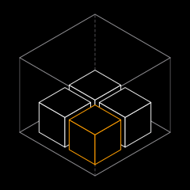
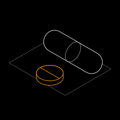
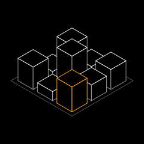
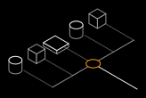
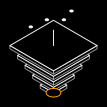
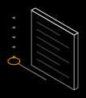
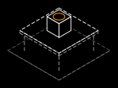
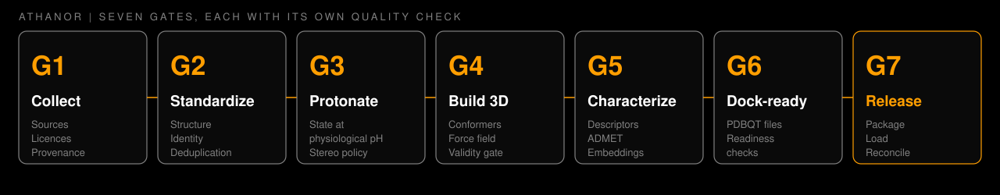
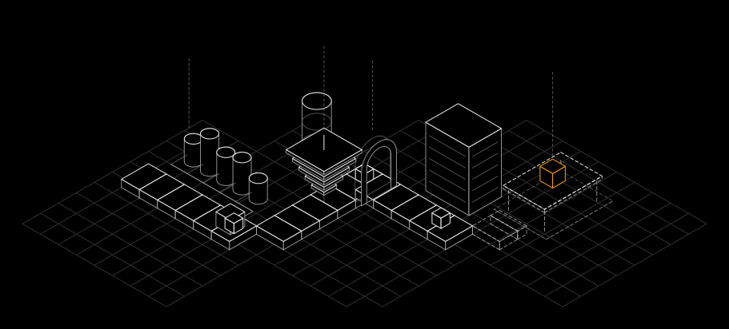

<div align="center">


<br>

<!-- numbers:begin badges -->
[](LICENSE)
[](CHANGELOG.md)
[](#at-a-glance)
<!-- numbers:end badges -->

[](https://aurora.alchemia.solutions)
[](docs/API.md)
[](#packages)
[](#the-five-top-level-collections)
[](docs/README.md)
[](CITATION.cff)
[](https://alchemia.solutions)

### AURORA is a molecular database for computer-aided drug design. Every compound has a curated structure, a validated 3D conformer, a docking file, computed features and its provenance.

ATHANOR, the private pipeline behind it, curates the data. Its seven gates are described in [docs/PIPELINE.md](docs/PIPELINE.md).

Release 2.0.0 is loaded in the production database (read 2026-11-18). It is not published: the packages
are built and staged in object storage, with a checksum for every file (manifest read 2026-11-20), and no
anonymous download is open. The platform is a closed beta for approved accounts. Nothing in this repository
promises a date or an access. The platform addresses that documents here point to are listed in
[`data/site-links.json`](data/site-links.json), the one place to check when the state changes.

<br>

<table>
<tr>
<td align="center" width="20%"><br><b>AURORA</b><br><sub>the full catalog</sub></td>
<td align="center" width="20%"><br><b>Natural Space</b><br><sub>natural products</sub></td>
<td align="center" width="20%"><br><b>Drug Space</b><br><sub>approved drugs, drug-like</sub></td>
<td align="center" width="20%"><br><b>Bioactivity Space</b><br><sub>measured activity</sub></td>
<td align="center" width="20%"><br><b>Diversity Space</b><br><sub>distinct structures</sub></td>
</tr>
</table>

<br>

[What it is](#what-it-is) · [How it works](#how-it-works) · [How it is made](#how-aurora-is-made) · [The platform](#the-platform) · [At a glance](#at-a-glance) · [Collections](#the-five-top-level-collections) · [Packages](#packages) · [Sources](#sources) · [Download and access](#download-and-access) · [Docs index](docs/README.md) · [Read the API](#read-aurora-through-the-api) · [Limits](#honest-limitations) · [Changelog](CHANGELOG.md) · [Cite](#citing) · [Contribute](#contributing)

</div>

---

## What it is

**AURORA** (Alchemia Unified Repository for Open Research Applications) is a molecular database for
computer-aided drug design, built and maintained by [ALCHEMIA SOLUTIONS](https://alchemia.solutions)
(legal entity Alchemia LTDA, Barretos, São Paulo, Brazil). ALCHEMIA is a Brazilian company that builds drug
design and discovery tools with AI, aimed at new cures. The data goes out in two packages, each under its
own licence: AURORA, under CC BY-SA 4.0, and AURORA-NC, under CC BY-NC 4.0. No package is published yet.
Each source keeps its own terms, and the licence status of some sources for the ShareAlike condition is not settled.

"Open" in the name refers to data under an open licence, the two packages each with its own licence. It
does not mean free access to everything, and it does not mean open source.

This repository describes the database: a standardized structure with an identifier, a
protonation state at physiological pH, a 3D conformer, a docking file, computed descriptors,
fingerprints, ADMET predictions, bioactivity measurements for part of the compounds, and the provenance of
each compound.

**ATHANOR** is the curation pipeline that produces it. It is private. The data is meant to be released under
Creative Commons licences, the furnace is not, and this repository says so plainly: it holds the
description of the database, the data model and examples that read the API. It holds no pipeline code, no
configuration and no per-compound data.

The registry does not compete on scale: libraries such as ZINC-22 distribute billions of compounds. Every
complete compound has an approved 3D conformer, a docking file and the core feature tables. Some exhaustive
descriptors are missing on some compounds, and some compounds have no computed protonation variant. The
collection includes natural products, among them Brazilian natural-product collections.

The release database of 2.0.0 also holds bioactivity measurements about compounds that AURORA already holds. Each row
keeps its own licence, and not every row is redistributable. The source names of these data are not
decided for public text (see [docs/SOURCES.md](docs/SOURCES.md)). AURORA does not replace
[ChEMBL](https://www.ebi.ac.uk/chembl/) as a bioactivity reference.

<table>
<tr><td valign="top">

**A good fit if you want to**

- study natural-product chemical space with consistent descriptors
- search by identifier, name or synonym through the API, with an account token, once the platform gives access
- prepare ligands from complete compounds, once a package is released (a file prepared for docking is not target-ready)

</td><td valign="top">

**Not a fit if you want**

- billions of make-on-demand compounds
- a replacement for [ChEMBL](https://www.ebi.ac.uk/chembl/) as the reference for bioactivity
- the curation source code

</td></tr>
</table>

## How it works

The same four steps open the platform's Home. The figures below are the ones the platform shows.

<table>
<tr>
<td align="center" width="25%"><br><b>1. Collect</b><br><sub>Public sources are read record by record, each with its licence.</sub></td>
<td align="center" width="25%"><br><b>2. Curate</b><br><sub>ATHANOR standardizes and deduplicates each structure and checks its 3D geometry.</sub></td>
<td align="center" width="25%"><br><b>3. Release</b><br><sub>The curated records are loaded into AURORA, each traced to its source.</sub></td>
<td align="center" width="25%"><br><b>4. Inspect</b><br><sub>With an approved account, search, filter and turn molecules in 3D in the Explorer.</sub></td>
</tr>
</table>

## How AURORA is made

Every compound in AURORA passes through **ATHANOR**, the private curation pipeline of Alchemia Solutions. An
athanor is the alchemist's slow furnace, built to hold a constant heat for months. The pipeline has seven
gates, **G1 to G7**, and each gate carries its own quality check rather than a bare count. A compound that
fails a gate does not move on.

<div align="center">

</div>

| Gate | What it does | What AURORA gets from it |
|---|---|---|
| **G1** Collect sources | Sources are registered, read and checked. Every record keeps its own licence verdict | A record that carries where it came from, and under which terms |
| **G2** Standardize and identify | Structures are validated and standardized, duplicates across sources merge, each compound gets an `ALC` identifier | One compound, one permanent identifier, names and cross-references |
| **G3** Set protonation | Each molecule is set to its state at physiological pH, under a stereochemistry policy | A declared protonation state per compound |
| **G4** Build 3D conformers | A 3D conformer is embedded, optimized and then validated by a validity gate | An approved 3D conformer, or an explicit mark that none was approved |
| **G5** Compute properties | Descriptors, fingerprints, structural alerts, predicted ADMET, scaffolds and a learned embedding are computed | The feature tables of every package |
| **G6** Prepare for docking | A PDBQT file is prepared and checked against readiness rules | A file that passed the readiness checks |
| **G7** Release and load | The release is exported, packaged with checksums, loaded and reconciled with the registry | A release whose loaded rows match its manifest |

Each gate is described in full, sub-stage by sub-stage, in **[docs/PIPELINE.md](docs/PIPELINE.md)**. The
pipeline exists because its predecessor reported near-total coverage while many of its files carried wrong
stereochemistry. The lesson is the rule of the project: no coverage metric detects a correctness error.

## The platform

<div align="center">

</div>

The **AURORA Platform** (contract read at version 1.5.1; version 1.5.2 has been in production since 2026-11-23 and the contract was not read again) is the way into the database: a REST API and a
web app at [aurora.alchemia.solutions](https://aurora.alchemia.solutions).

| Page | What you do there |
|---|---|
| **Home** | See the four steps, the five collections, the sources and a preview of the Explorer |
| **Collections** | Read each collection's rule, its provenance and its packages, and fetch its bundles |
| **Explorer** | Search and filter the catalog, turn a molecule in 3D, read its identity, properties and predicted ADMET, and use **Download Data** for one compound |
| **Dashboard** | Read charts that describe the database |
| **Docs** | Methods, data dictionary, API, tutorials, licence, privacy and how to cite |
| **Collaborate** | Register a study or suggest a database for ATHANOR to consider |
| **Profile** | Manage the account and its API access |

Access is described in [Download and access](#download-and-access).

## At a glance

<!-- numbers:begin glance -->
| | | Read on |
|---|---:|---|
| Complete compounds of the release: approved 3D geometry, SDF and PDBQT | 1,000,000 | 2026-11-18 |
| Incomplete compounds, kept apart, in no package and not in the API | 15,021 | 2026-11-18 |
| Complete and incomplete, both areas | 1,015,021 | 2026-11-18 |
| Package AURORA (licence CC BY-SA 4.0) | 983,687 | 2026-11-18 |
| Package AURORA-NC (licence CC BY-NC 4.0), in addition | 16,313 | 2026-11-18 |
| Learned embeddings, across both packages | 1,000,000 | 2026-11-18 |
| Name rows (rows, not distinct names) | 9,339,498 | 2026-11-18 |

*Population: release 2.0.0, loaded in the production database and not published; counts read in that database. Status: release 2.0.0 loaded in the production database (read 2026-11-18), no package published. The two packages add up to the complete set: 983,687 + 16,313 = 1,000,000. The release as a whole has 1,000,000 complete compounds, in two packages. The embeddings and name rows are row counts of their tables, read in that database; the content of the tables was not compared. Each figure carries the date it was read.*
<!-- numbers:end glance -->

The complete set is what the platform and the download packages are meant to serve. The incomplete area is
kept, marked, and never mixed into them. Every figure above is copied from `data/numbers.json` with its
date by `scripts/gen_numbers.py`; none is typed by hand. The figures are readings of the release database
of 2.0.0; the release is not published. Not printed here, because they are not decided or not measured for
public text: bioactivity counts, counts per collection, a number of sources.

## The five top-level collections

AURORA, Natural Space, Drug Space, Bioactivity Space and Diversity Space. The registry also holds
subcollections of these, one level deep, and they roll up into their parent, so the platform's collection
summary lists more rows than five and the rows overlap. The list of collections can change before the
release, and no count per collection is printed here. See [docs/COLLECTIONS.md](docs/COLLECTIONS.md).

## Packages

The complete compounds of the release go out in two packages. Each compound belongs to exactly one, so the
packages do not overlap, and the counts are in [At a glance](#at-a-glance).

| Package | Licence | Who can fetch it, as the platform is built | Carries bioactivity rows |
|---|---|---|---|
| **AURORA** | CC BY-SA 4.0 | an approved account, scope `download` | yes, in the per-compound package |
| **AURORA-NC** | CC BY-NC 4.0 | an approved account that accepted the NC terms (see Scopes), scope `download_nc` | no |

Both come in two shapes.

**Bundles by collection.** Each collection has a set of six bundles, one per type, each a `.tar.zst`:

| Type | What is inside |
|---|---|
| `sdf`, `pdbqt` | one `ALC<n>.sdf` or `ALC<n>.pdbqt` per compound; SDF is the canonical format, PDBQT is derived from it |
| `descriptors` | 2D physicochemical properties, one row per compound |
| `descriptors3d` | 3D shape descriptors, one row per compound |
| `admet` | ADMET-AI predictions, with the controls that say how many are missing. Predictions, not measurements |
| `fingerprints` | Morgan (2048 and 1024 bits), MACCS, atom-pair, torsion and E3FP, in Parquet |

Every bundle also carries `license_per_row.tsv` (the licence and the attribution of each compound), an
`ATTRIBUTION.md` and a `SHA256SUMS`. The AURORA package has a set of bundles for each of the five
collections (AURORA, Natural Space, Drug Space, Bioactivity Space and Diversity Space). The AURORA-NC package
has them for four of those: the full catalog, Natural Space, Drug Space and Diversity Space. There is no NC
bundle for Bioactivity Space, because AURORA-NC carries no bioactivity rows.

**One package per compound.** Each compound has a `.zip` named `ALC<n>.zip`, for pulling one molecule. It holds:

- `sdf/` and `pdbqt/` with the structure and the docking file;
- `descriptors.tsv`, `descriptors3d.tsv`, `admet.tsv` and `fingerprints.tsv`;
- `license.tsv`, `ATTRIBUTION.md`, `LICENSE` and a `README.md`;
- `activities.tsv`, only in an AURORA package and only for a compound that has bioactivity rows the licence
  lets us serve. A compound without such rows has no `activities.tsv`, and its README says so.

**What the bundles do not carry.** No collection bundle has identity tables (canonical SMILES, InChIKey, names,
cross-references), classification, scaffolds, protonation microstates, drug annotations, embeddings or the
link of each compound to its sources beyond `license_per_row.tsv`. The structure files carry the structure,
and the database holds the rest. Detail in [docs/SCHEMA.md](docs/SCHEMA.md) and
[docs/DATA_DICTIONARY.md](docs/DATA_DICTIONARY.md).

A file prepared for docking is not target-ready: see [Honest limitations](#honest-limitations).

## Sources

AURORA draws on the public collections below. The raw dumps are not redistributed: for those, go to the
original projects. Attribution names Alchemia LTDA for the curation and aggregation, and it does not replace
the original sources: if you publish work built on a subset, cite the upstream projects too. The terms in the
table are the sources' own words as recorded on the dates in [docs/SOURCES.md](docs/SOURCES.md), not a promise
of ours. Read them at the source before you build on a subset.

| Source | Package of the source | Terms as recorded | Reference |
|---|---|---|---|
| **COCONUT 2.0**, with its ZINC NP fraction | AURORA | Download page: CC0 | [10.1093/nar/gkae1063](https://doi.org/10.1093/nar/gkae1063) |
| **NCI / DTP** Open Chemical Repository | AURORA | Structures in the public domain | RRID:SCR_003057 |
| **ChEBI** | AURORA | CC BY 4.0, EMBL-EBI terms | [10.1093/nar/gkaf1271](https://doi.org/10.1093/nar/gkaf1271) |
| **ChEMBL** 37 | AURORA | CC BY-SA 3.0, attribution by row | [10.1093/nar/gkad1004](https://doi.org/10.1093/nar/gkad1004) |
| **BrNPDB** | AURORA | No data licence stated on the site | [10.1021/np3006875](https://doi.org/10.1021/np3006875) |
| **BraCoLi** v1 | AURORA | No data licence stated on the site | [10.1007/s11030-022-10386-9](https://doi.org/10.1007/s11030-022-10386-9) |
| **IRACEMA** | AURORA | No data licence stated on the site | [10.1021/acsomega.5c11939](https://doi.org/10.1021/acsomega.5c11939) |
| **TCMBank** | AURORA-NC | No data licence stated; the site calls itself non-commercial | [10.1039/d3sc02139d](https://doi.org/10.1039/d3sc02139d) |
| **Drug Repurposing Hub** | AURORA-NC | "Provided for non-commercial use only" | [10.1038/nm.4306](https://doi.org/10.1038/nm.4306) |
| **AntibioticDB** (GARDP) | AURORA-NC | Terms for non-commercial use | [10.1021/acsinfecdis.5c00955](https://doi.org/10.1021/acsinfecdis.5c00955) |

"Package of the source" is the set the source belongs to. A compound goes to AURORA when at least one of its
sources is in the AURORA set, and to AURORA-NC otherwise, so an NC source can appear on a compound of the AURORA
package. BindingDB is not a source of compounds: its measurements enter only as bioactivity rows about
compounds AURORA already holds, each row with its own licence. The second paper of each source, where there
is one, and the sentence each source asks for are in [docs/SOURCES.md](docs/SOURCES.md).

## Read AURORA through the API

The platform is meant to expose a versioned REST API at `https://aurora.alchemia.solutions/v1/`.
To start, read [docs/QUICKSTART.md](docs/QUICKSTART.md): from an account to an API key and your first call, checked in
production on 2026-11-25. [docs/API.md](docs/API.md) lists the routes of the OpenAPI contract, the one that needs no token and the
ones that need a Bearer token. Examples that only read are in [`examples/`](examples/) (Python and curl).
Nobody gets direct database access, not even read-only: the surface is file packages plus the API. No
package is published.

## Download and access

Platform version 1.5.2 (commit `9363ed5`) has been in production since 2026-11-23, 22:18 UTC (read from the platform's deploy report). It replaced version 1.5.1 (commit `7030a42`). The deploy checks of 2026-11-23 found the anonymous pages answering and the old Terms and Download addresses redirecting. The full smoke test with a real account (sign-in, new acceptance of the Terms and the Policy 1.1, SA and NC download) is not done yet. The routes, scopes and switches below are read from the contract of version 1.5.1 of
2026-11-23, which [docs/API.md](docs/API.md) follows, and from the packages manifest of 2026-11-20.

- **Release 2.0.0** is loaded and not published: no tag, no release, no DOI, no anonymous download.
- **The platform** is a closed beta for approved accounts. The Terms of Use and the Privacy Policy are in
  version 1.1 since version 1.5.2, and every account accepts them again at its next sign-in. **Sign-up is open** at the platform, by request: a new account is created pending,
  an administrator approves it, and the approval is announced by an e-mail from `contact@alchemia.solutions`
  with a button to log in. Without an approved account only the Home page and the sign-in page open (checked on 2026-11-25). No date is promised for
  access without an account.
- **How to download.** Sign in with an approved account. The bundles are offered in the `#downloads` section of each collection page; version 1.5.2 has no separate Download page, and the old addresses (`/downloads`, `/downloads/{slug}`, `/collections/{slug}/download`, `/terms`) answer 308. The Explorer has a "Download Data" button for one compound. The one-compound package has its own API route,
  `GET /v1/compounds/{alchemia_id}/package`, and the route `GET /v1/capabilities` says whether the instance
  offers it to your session ([docs/API.md](docs/API.md)).
  Files are handed over through a short-lived signed link, never as a public address.
- **Scopes.** An account token carries the scope `download` for the AURORA package. The AURORA-NC package needs
  the scope `download_nc`. In version 1.5.2 an account that accepted the Terms and the Policy at sign-up holds it with no second acceptance, and withdrawing the acceptance closes the access. An account
  without it is told that an NC compound does not exist: it is not shown the compound, the file or the count.
- **Switches** (read in production on 2026-11-25): the one-compound package is on; API keys are on and only read;
  similarity and substructure search are off and answer 503. The full table is in [docs/QUICKSTART.md](docs/QUICKSTART.md#what-this-deployment-offers-today).
- **The API** needs a Bearer token from an approved account, except the health probes, the sign-in doors and
  one route of aggregates ([docs/API.md](docs/API.md)).
- **Bioactivity routes** are on in production (2026-11-25) for the signed-in session; an API key is refused on
  them (`403 api_key_not_allowed`).
- **This repository** describes the database. It is not the database.

## Honest limitations

- The registry does not compete on scale. Libraries such as ZINC-22 distribute billions of compounds.
- AURORA does not replace ChEMBL as a bioactivity reference. Its bioactivity rows are about the compounds it
  holds, each with its own licence, and not every row is redistributable.
- ADMET values are predictions, never measurements. Treat them as triage.
- Stereoisomers are not enumerated. A compound whose source left stereo undefined keeps it undefined, and
  is flagged.
- Some compounds have no approved 3D geometry. They live in a separate, marked area and are not mixed
  into the packages or the API.
- Each source has its own terms, which is why a second package, AURORA-NC, exists. The licence status of
  some sources is under review (see docs/SOURCES.md). Read the terms at the source before you build on a
  subset.
- No DOI is minted for the dataset.
- A file prepared for docking means the file passed the checks of the pipeline. It does not mean that protonation and
  tautomer states are validated for every target.

## Licence

| What | Licence | File |
|---|---|---|
| Documentation and figures of this repository, except the marks they carry | CC BY-SA 4.0 | [LICENSE](LICENSE) |
| Package AURORA (not yet published) | CC BY-SA 4.0 | [LICENSE](LICENSE) |
| Package AURORA-NC (not yet published) | CC BY-NC 4.0 | [LICENSE](LICENSE) |
| Code in `examples/` and `scripts/` | Apache-2.0 | [LICENSE-CODE](LICENSE-CODE) |

No package is published yet. Each compound belongs to exactly one package and carries that package's licence.
Each source keeps its own terms, and the licence status of some sources for the ShareAlike condition is not
settled. The ATHANOR pipeline is not in this repository and no licence here grants any right in it. The
ALCHEMIA, ATHANOR and AURORA names and symbols are trademarks of Alchemia LTDA (see [LICENSE](LICENSE)). The
names, wordmarks and symbols inside the figures are not licensed under CC BY-SA.

## Citing

Cite AURORA by name and publisher, the release you used and the date you accessed it. The author is Alchemia
LTDA and the publisher is Alchemia Solutions. The release is shown on the platform. There is no DOI. Cite the
upstream sources you used too, listed in [Sources](#sources) and [docs/SOURCES.md](docs/SOURCES.md). A
machine-readable form is in [`CITATION.cff`](CITATION.cff).

```bibtex
@misc{aurora,
  title        = {AURORA},
  author       = {{Alchemia LTDA}},
  publisher    = {Alchemia Solutions},
  howpublished = {Online platform. Access is by an approved account},
  url          = {https://aurora.alchemia.solutions},
  note         = {Add the release you used and the date you accessed it. No DOI has been issued.}
}
```

## Contributing

To register a study or to ask that a molecule database be considered by ATHANOR, use
[Collaborate](https://aurora.alchemia.solutions/collaborate) on the platform, which needs an approved
account during the beta. In this repository, issues and pull requests are welcome for documentation,
examples, corrections to the source list and questions. See [CONTRIBUTING.md](CONTRIBUTING.md), the
[Code of Conduct](CODE_OF_CONDUCT.md) and [SECURITY.md](SECURITY.md). Questions and proposals for
partnerships: contact@alchemia.solutions. The organization is at
[github.com/alchemia-solutions](https://github.com/alchemia-solutions).

## Layout

```
README.md  CHANGELOG.md  LICENSE  LICENSE-CODE  CITATION.cff
CONTRIBUTING.md  CODE_OF_CONDUCT.md  SECURITY.md
assets/      banner, gates figure, flow and collection symbols from the brand system (generated, never edited by hand)
data/        numbers.json (the figures) and site-links.json (the platform links)
docs/        SOURCES, PIPELINE, SCHEMA, DATA_DICTIONARY, COLLECTIONS, API, FAQ
examples/    read-only calls to the API (Python, curl)
scripts/     gen_numbers.py writes the figures; check_links.py checks the links
.github/     issue and pull request templates (no README: GitHub would show it instead of this one)
```

Each folder has its own `README.md`, except `.github/` and its `ISSUE_TEMPLATE/` child, where GitHub reads
every file as configuration or as a template.

Repository: [github.com/alchemia-solutions/aurora](https://github.com/alchemia-solutions/aurora).
