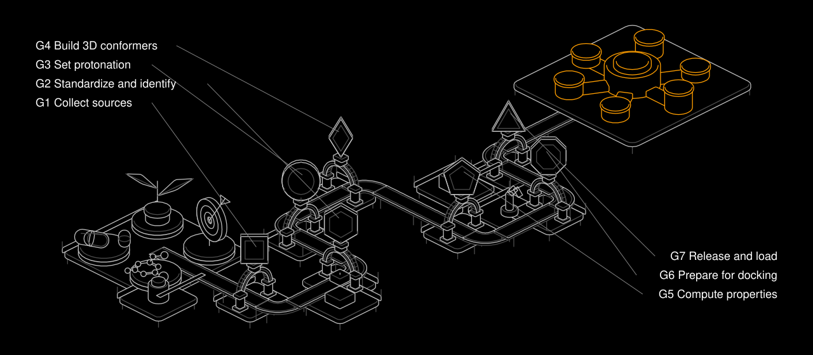

<div align="center">


<br>

<!-- numbers:begin badges -->
[](LICENSE)
[](CHANGELOG.md)
[](#at-a-glance)
<!-- numbers:end badges -->

**ATHANOR curates the data. AURORA is the database it produces.**

Release 2.0.0 is loaded in the production database (read 2026-11-18). It is not published: no download
package is published, and the platform is a closed beta for approved accounts. Nothing in this repository promises a date or an access. The platform
addresses that documents here point to are listed in [`data/site-links.json`](data/site-links.json), the one
place to check when the state changes.

[What it is](#what-it-is) · [The pipeline](#the-athanor-pipeline) · [At a glance](#at-a-glance) · [Collections](#the-five-top-level-collections) · [Sources](docs/SOURCES.md) · [Docs index](docs/README.md) · [Read the API](#read-aurora-through-the-api) · [Limits](#honest-limitations) · [Changelog](CHANGELOG.md) · [Cite](#citing) · [Contribute](#contributing)

</div>

---

## What it is

**AURORA** (Alchemia Unified Repository for Open Research Applications) is a molecular database for
computer-aided drug design, built and maintained by [ALCHEMIA SOLUTIONS](https://alchemia.solutions)
(legal entity Alchemia LTDA, Barretos, São Paulo, Brazil). ALCHEMIA is a Brazilian company that builds drug
design and discovery tools with AI, aimed at new cures. The data goes out in two packages, each under its
own licence: AURORA, under CC BY-SA 4.0, and AURORA-NC, under CC BY-NC 4.0. No package is published yet.
Each source keeps its own terms, and the licence status of some sources for the ShareAlike condition is not settled.

"Open" in the name refers to data under an open licence, the two packages each with its own licence. It
does not mean free access to everything, and it does not mean open source.

This repository describes the database: a standardized structure with an identifier, a
protonation state at physiological pH, a 3D conformer, a docking file, computed descriptors,
fingerprints, ADMET predictions, bioactivity measurements for part of the compounds, and the provenance of
each compound.

**ATHANOR** is the curation pipeline that produces it. It is private. The data is meant to be released under
Creative Commons licences, the furnace is not, and this repository says so plainly: it holds the
description of the database, the data model and examples that read the API. It holds no pipeline code, no
configuration and no per-compound data.

The registry does not compete on scale: libraries such as ZINC-22 distribute billions of compounds. Every
complete compound has an approved 3D conformer, a docking file and the core feature tables. Some exhaustive
descriptors are missing on some compounds, and some compounds have no computed protonation variant. The
collection includes natural products, among them Brazilian natural-product collections.

The release database of 2.0.0 also holds bioactivity measurements about compounds that AURORA already holds. Each row
keeps its own licence, and not every row is redistributable. The source names of these data are not
decided for public text (see [docs/SOURCES.md](docs/SOURCES.md)). AURORA does not replace
[ChEMBL](https://www.ebi.ac.uk/chembl/) as a bioactivity reference.

<table>
<tr><td valign="top">

**A good fit if you want to**

- study natural-product chemical space with consistent descriptors
- search by identifier, name or synonym through the API, with an account token, once the platform gives access
- prepare ligands from complete compounds, once a package is released (docking-ready is not target-ready)

</td><td valign="top">

**Not a fit if you want**

- billions of make-on-demand compounds
- a replacement for [ChEMBL](https://www.ebi.ac.uk/chembl/) as the reference for bioactivity
- the curation source code

</td></tr>
</table>

## The ATHANOR pipeline

An athanor is the alchemist's slow furnace, built to hold a constant heat for months. The pipeline has
seven macro-stages, each with a quality gate rather than a bare count.

<div align="center">

</div>

| Stage | What it does |
|---|---|
| **G1** Collect sources | Each record is collected with its source and license |
| **G2** Standardize and identify | Validates and standardizes each structure, merges duplicates and gives each unique compound an `ALC<n>` identifier |
| **G3** Set protonation | Each molecule is prepared in the forms used for modeling, at physiological pH |
| **G4** Build 3D conformers | A 3D geometry is generated and checked. It is approved, or marked as missing |
| **G5** Compute properties | Each molecule is described by descriptors, fingerprints, structural alerts, ADMET predictions, scaffolds and a learned embedding |
| **G6** Prepare for docking | Files are prepared for docking and checked |
| **G7** Release and load | The release is assembled and loaded |

More in [docs/PIPELINE.md](docs/PIPELINE.md). The pipeline exists because its predecessor reported
near-total coverage while many of its files carried wrong stereochemistry. The lesson is the rule of the
project: no coverage metric detects a correctness error.

## At a glance

<!-- numbers:begin glance -->
| | | Read on |
|---|---:|---|
| Complete compounds of the release: approved 3D geometry, SDF and PDBQT | 1,000,000 | 2026-11-18 |
| Incomplete compounds, kept apart, in no package and not in the API | 15,021 | 2026-11-18 |
| Complete and incomplete, both areas | 1,015,021 | 2026-11-18 |
| Package AURORA (licence CC BY-SA 4.0) | 983,687 | 2026-11-18 |
| Package AURORA-NC (licence CC BY-NC 4.0), in addition | 16,313 | 2026-11-18 |
| Learned embeddings, across both packages | 1,000,000 | 2026-11-18 |
| Name rows (rows, not distinct names) | 9,339,498 | 2026-11-18 |

*Population: release 2.0.0, loaded in the production database and not published; counts read in that database. Status: release 2.0.0 loaded in the production database (read 2026-11-18), no package published. The two packages add up to the complete set: 983,687 + 16,313 = 1,000,000. The release as a whole has 1,000,000 complete compounds, in two packages. The embeddings and name rows are row counts of their tables, read in that database; the content of the tables was not compared. Each figure carries the date it was read.*
<!-- numbers:end glance -->

The complete set is what the platform and the download packages are meant to serve. The incomplete area is
kept, marked, and never mixed into them. Every figure above is copied from `data/numbers.json` with its
date by `scripts/gen_numbers.py`; none is typed by hand. The figures are readings of the release database
of 2.0.0; the release is not published. Not printed here, because they are not decided or not measured for
public text: bioactivity counts, counts per collection, a number of sources.

## The five top-level collections

AURORA, Natural Space, Drug Space, Bioactivity Space and Diversity Space. The registry also holds
subcollections of these, one level deep, and they roll up into their parent, so the platform's collection
summary lists more rows than five and the rows overlap. The list of collections can change before the
release, and no count per collection is printed here. See [docs/COLLECTIONS.md](docs/COLLECTIONS.md).

## Planned package layout

No package is published and no date is promised. The planned contents are structure files (SDF, the
canonical format, and PDBQT, derived from it), feature tables in Parquet, a manifest with a SHA-256 for every
file, the SQL schema and the citation files. How these are grouped into archives is not settled. Detail in [docs/SCHEMA.md](docs/SCHEMA.md) and
[docs/DATA_DICTIONARY.md](docs/DATA_DICTIONARY.md). No release package is published (see
[Availability](#availability)).

## Sources

AURORA draws on public collections. The list, with references, is in [docs/SOURCES.md](docs/SOURCES.md);
the public list of sources of release 2.0.0 is not decided. Attribution names Alchemia LTDA and the original
sources: the curation does not replace them, and if you publish work built on a subset, cite the upstream
projects too.

## Read AURORA through the API

The platform is meant to expose a versioned REST API at `https://aurora.alchemia.solutions/v1/`.
[docs/API.md](docs/API.md) lists the routes of the OpenAPI contract, the one that needs no token and the
ones that need a Bearer token. Examples that only read are in [`examples/`](examples/) (Python and curl).
Nobody gets direct database access, not even read-only: the planned surface is file packages plus the
API. No package is published.

## Availability

State on 2026-11-17, read from the contract of platform version 1.4.0 of the closed beta; the instance that
answers may differ:

- **Release 2.0.0** is in preparation. Nothing of it is published: no tag, no release, no download package.
- **The platform** is a closed beta for approved accounts. The Terms of Use, the Licence page and the Privacy
  Policy are final (version 1.0). Sign-up for the public is not open: it opens as its own step after the next
  platform release is cut, and no date is promised.
- **The API** needs a Bearer token from an approved account, except the health probes, the sign-in doors and
  one route of aggregates ([docs/API.md](docs/API.md)).
- **Download packages** are not published, and nothing here promises them.
- **Bioactivity routes** are behind switches that are off in that contract. The substructure and similarity
  search routes are off in the beta.
- **This repository** describes the database. It is not the database.

## Honest limitations

- The registry does not compete on scale. Libraries such as ZINC-22 distribute billions of compounds.
- AURORA does not replace ChEMBL as a bioactivity reference. Its bioactivity rows are about the compounds it
  holds, each with its own licence, and not every row is redistributable.
- ADMET values are predictions, never measurements. Treat them as triage.
- Stereoisomers are not enumerated. A compound whose source left stereo undefined keeps it undefined, and
  is flagged.
- Some compounds have no approved 3D geometry. They live in a separate, marked area and are not mixed
  into the packages or the API.
- Each source has its own terms, which is why a second package, AURORA-NC, exists. The licence status of
  some sources is under review (see docs/SOURCES.md). Read the terms at the source before you build on a
  subset.
- No DOI is minted for the dataset.
- "Docking-ready" means the files passed the checks of the pipeline. It does not mean that protonation and
  tautomer states are validated for every target.

## Licence

| What | Licence | File |
|---|---|---|
| Documentation and figures of this repository, except the marks they carry | CC BY-SA 4.0 | [LICENSE](LICENSE) |
| Package AURORA (not yet published) | CC BY-SA 4.0 | [LICENSE](LICENSE) |
| Package AURORA-NC (not yet published) | CC BY-NC 4.0 | [LICENSE](LICENSE) |
| Code in `examples/` and `scripts/` | Apache-2.0 | [LICENSE-CODE](LICENSE-CODE) |

No package is published yet. Each compound belongs to exactly one package and carries that package's licence.
Each source keeps its own terms, and the licence status of some sources for the ShareAlike condition is not
settled. The ATHANOR pipeline is not in this repository and no licence here grants any right in it. The
ALCHEMIA, ATHANOR and AURORA names and symbols are trademarks of Alchemia LTDA (see [LICENSE](LICENSE)). The
names, wordmarks and symbols inside the figures are not licensed under CC BY-SA.

## Citing

Cite AURORA by name and publisher, the release you used and the date you accessed it. The release is shown
on the platform. There is no DOI. Cite the upstream sources you used too, listed in
[docs/SOURCES.md](docs/SOURCES.md). A machine-readable form is in [`CITATION.cff`](CITATION.cff).

## Contributing

To register a study or to ask that a molecule database be considered by ATHANOR, use
[Collaborate](https://aurora.alchemia.solutions/collaborate) on the platform, which needs an approved
account during the beta. In this repository, issues and pull requests are welcome for documentation,
examples, corrections to the source list and questions. See [CONTRIBUTING.md](CONTRIBUTING.md), the
[Code of Conduct](CODE_OF_CONDUCT.md) and [SECURITY.md](SECURITY.md). Questions and proposals for
partnerships: contact@alchemia.solutions. The organization is at
[github.com/alchemia-solutions](https://github.com/alchemia-solutions).

## Layout

```
README.md  CHANGELOG.md  LICENSE  LICENSE-CODE  CITATION.cff
CONTRIBUTING.md  CODE_OF_CONDUCT.md  SECURITY.md
assets/      figures and collection symbols from the brand system (generated, never edited by hand)
data/        numbers.json (the figures) and site-links.json (the platform links)
docs/        SOURCES, PIPELINE, SCHEMA, DATA_DICTIONARY, COLLECTIONS, API, FAQ
examples/    read-only calls to the API (Python, curl)
scripts/     gen_numbers.py writes the figures; check_links.py checks the links
.github/     issue and pull request templates (no README: GitHub would show it instead of this one)
```

Each folder has its own `README.md`, except `.github/` and its `ISSUE_TEMPLATE/` child, where GitHub reads
every file as configuration or as a template.

Repository: [github.com/alchemia-solutions/aurora](https://github.com/alchemia-solutions/aurora).
