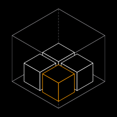
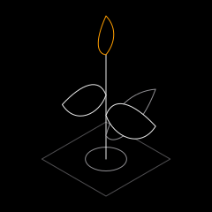
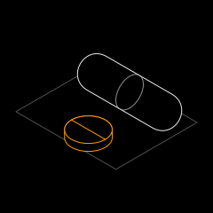
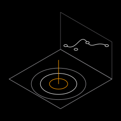
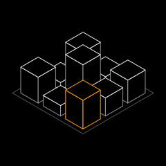

# Collections

[Repository home](../README.md) · [Docs index](README.md)

The platform groups the complete compounds of the main package in five top-level collections. The registry
also holds subcollections of these, one level deep, and a member of a subcollection is a member of its
parent; the platform's collection summary therefore lists more rows than five. A compound can belong to more
than one collection, so rows overlap and are not added. The criterion of each collection is shown on the platform, on the page of the
collection. The list can change before release 2.0.0 is published, and no count per collection is printed
here.

| Collection | What it holds |
|---|---|
| **AURORA** | The complete compounds of the main package |
| **Natural Space** | Natural products |
| **Drug Space** | Criterion shown on the platform |
| **Bioactivity Space** | Criterion shown on the platform |
| **Diversity Space** | Criterion shown on the platform |

## Where to open them

The platform is a closed beta for approved accounts. In the contract of platform version 1.4.0 the
[Collections](https://aurora.alchemia.solutions/collections) pages, the
[Explorer](https://aurora.alchemia.solutions/explorer) and the download of a collection need one; the
instance that answers may differ. Sign-up
for the public is not open: it opens as its own step after the next platform release is cut, with no date. No download package is published, and nothing
here promises one.
