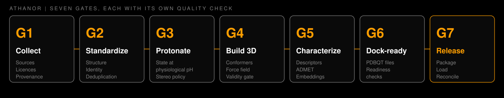
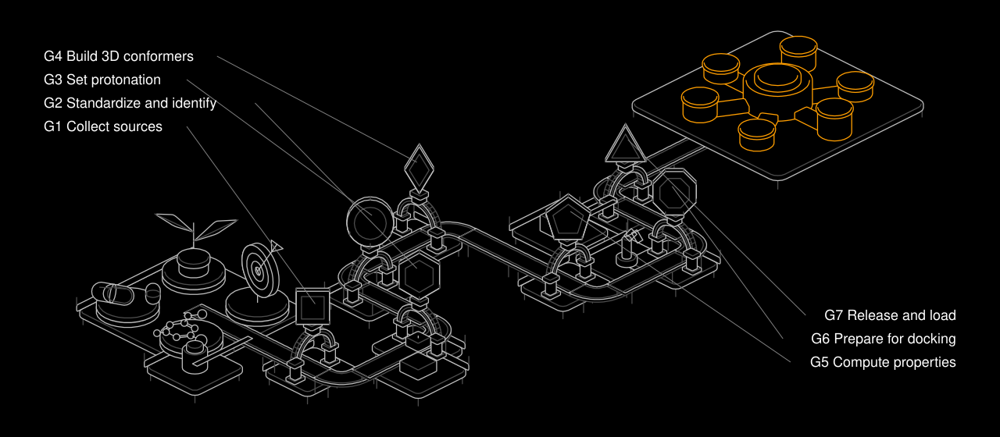

# The ATHANOR pipeline: seven gates and their sub-stages

[Repository home](../README.md) · [Docs index](README.md)

ATHANOR is the curation pipeline that turns public compound collections into the AURORA database. It is
private. This page describes **what each gate does and what each sub-stage guarantees**, at the level of a
headline. It gives no parameter, no threshold, no tool setting and no code, and it will not.

An athanor is the alchemist's slow furnace, built to hold a constant heat for months. The pipeline has
**seven gates, G1 to G7**. The G stands for gate: each one ends in a quality check that decides whether a
compound moves on. Inside a gate, the work is split into **sub-stages** with a stable code, `S<gate>.<n>`
(so `S4.4` is the fourth sub-stage of G4). Each sub-stage has one thing it must guarantee, and a gate passes
only when its sub-stages do.

## At a glance

| Gate | Name | Sub-stages | What leaves the gate |
|---|---|---|---|
| **G1** | Collect sources | S1.1 to S1.7 | Records with their source, licence verdict and normalized annotations |
| **G2** | Standardize and identify | S2.1 to S2.11 | One compound per chemical identity, each with a permanent `ALC` identifier |
| **G3** | Set protonation | S3.1 to S3.3 | A declared protonation state per compound, under a stereochemistry policy |
| **G4** | Build 3D conformers | S4.1 to S4.5 | An approved 3D conformer, or a mark that none was approved |
| **G5** | Compute properties | S5.1 to S5.10 | Descriptors, fingerprints, alerts, predicted ADMET, scaffolds, embeddings |
| **G6** | Prepare for docking | S6.1 to S6.2 | A PDBQT file that passed the readiness checks |
| **G7** | Release and load | S7.1 to S7.8 | A release whose loaded rows match its manifest |

## G1. Collect sources

Every record enters with its source and its licence. Nothing is read from a source whose terms were not
decided, and a licence is a mark on each record, never a silent filter.

| Sub-stage | What it does | What it guarantees |
|---|---|---|
| **S1.1** Source registration | Registers each source with the number of records it declares and its licence decision | The records counted on disk equal the records the source declares, and every source in the run has a cleared licence |
| **S1.2** Record ingestion | Reads the records of each source | Records in equal records out plus records rejected, and every rejection has a reason |
| **S1.3** Record-level licensing | Attaches a licence verdict to every record | No record without a verdict, and every compound has at least one link to a source |
| **S1.4** Organism taxonomy normalization | Maps the organism names that sources give to the NCBI Taxonomy | Every name has a method and, when resolved, a confidence. Unresolved and ambiguous names are listed |
| **S1.5** Target normalization | Maps the targets named by activities and drug annotations to UniProt | Exact keys only, nothing fuzzy. Coverage is measured and unresolved keys are listed |
| **S1.6** Drug annotation | Normalizes clinical phase, mechanism and indication where a source carries them | Every phase value is normalized by a declared pattern or counted as unmapped, and every row has a licence verdict |
| **S1.7** Source variables without a table yet | Keeps extra variables a source declares (today the ChEBI ontology, definitions and roles), and compares each source formula and mass with the computed ones | A term or edge that breaks the data contract is refused with a counted reason |

## G2. Standardize and identify

The structure is validated and standardized, duplicates across sources are merged, and each compound receives
a permanent identifier, the `ALC<n>` number.

| Sub-stage | What it does | What it guarantees |
|---|---|---|
| **S2.1** Structure validation | Checks each structure with a structure checker | Every record has a checker score and a QC status |
| **S2.2** Standardization and parent extraction | Standardizes the structure and extracts the parent compound | The difference before and after is recorded for every record, with its reason |
| **S2.3** Quarantine adjudication | Reviews the records that were quarantined | Every quarantined record has a destination, and every unresolved one is named with its reason |
| **S2.4** Chemical identity and stereo annotation | Computes the chemical identity and annotates stereochemistry | The identity string reads back to the same structure for every compound |
| **S2.5** Persistent identifier registry and deduplication | Merges the same chemical identity found in several sources and assigns the `ALC` identifier in an append-only registry | One identity, one identifier, and no gaps in the numbering |
| **S2.6** Tautomer-insensitive grouping | Groups compounds that differ only by tautomer | Every compound is keyed, and the group-size distribution is reported |
| **S2.7** Compound classification | Assigns each compound to a collection | A compound never lands in a different collection depending on which source it came from |
| **S2.8** Name and synonym annotation | Types and attributes every name and synonym | Every name has a type, the rule that typed it, its source and its licence verdict |
| **S2.9** Stereoisomer grouping | Groups stereoisomers by the connectivity block of the InChIKey | Every compound is keyed, and the group-size distribution is reported |
| **S2.10** Cross-reference resolution by InChIKey | Looks up each compound in PubChem by InChIKey | Every compound has a lookup status, and coverage is measured before and after |
| **S2.11** Public identifier lookup | Finds the ChEBI, ChEMBL and PubChem CID identifiers of each compound | Every compound has an identifier or an explicit "absent" row for each of the three databases, and a truncated source is refused instead of being read as "absent" |

## G3. Set protonation

Each molecule is set to its state at physiological pH, so the 3D step and the docking file start from a
declared state.

| Sub-stage | What it does | What it guarantees |
|---|---|---|
| **S3.1** Protonation microstate enumeration | Enumerates the protonation states a molecule can take around physiological pH | The formal charge of every variant is coherent with the pH window |
| **S3.2** Dominant microstate selection | Selects the dominant state | Exactly one dominant state per compound that has variants |
| **S3.3** Stereochemistry policy | Applies the stereochemistry policy to the prepared structure | Any difference between the prepared and the curated identity is explained by a flag or named for review |

A subset of compounds has no computed protonation variant. That column is nullable and means what it says.

## G4. Build 3D conformers

A 3D geometry is built, optimized and then judged. This is the gate where the predecessor of the pipeline
failed, so the check is a correctness check and not a count.

| Sub-stage | What it does | What it guarantees |
|---|---|---|
| **S4.1** Conformer embedding | Embeds a 3D conformer for each molecule | The failure rate is reported per class, and every failure has its reason |
| **S4.2** Force-field optimization | Minimizes the geometry with a force field | Every geometry has a finite energy and a recorded minimizer |
| **S4.3** Embedding rescue | Retries the molecules whose geometry failed the validity gate, by another route | The rescued over attempted ratio is reported per failure class |
| **S4.4** 3D validity gate | Judges every conformer, including its bond angles and stereochemistry | A verdict with its reason for every conformer. This gate runs on 100% of the compounds, not on a sample |
| **S4.5** Internal-energy audit | Audits the internal energy of a stratified sample of approved geometries | The failure rate of the population is bounded with a statistical interval, and the rate per source and per stratum is reported |

A compound without an approved geometry is not discarded. It is kept, marked, in a separate area with its
full chemical identity.

## G5. Compute properties

Every compound receives its descriptors and predictions. Predictions are never presented as measurements.

| Sub-stage | What it does | What it guarantees |
|---|---|---|
| **S5.1** 2D descriptors | Computes the physicochemical and topological descriptors | Required descriptors are never null, and every null value of the others has a code that says why |
| **S5.2** Molecular fingerprints | Computes the fingerprints (Morgan, MACCS, atom-pair, torsion and a hashed 2D fingerprint) | No empty fingerprint, and every compound has a vector or a recorded parse error |
| **S5.3** 3D shape descriptors and E3FP | Computes shape descriptors and the E3FP fingerprint from the approved conformer | One row per approved conformer, tied to that conformer |
| **S5.4** Structural alerts and drug-likeness | Flags structural alerts and applies the published drug-likeness rules | Full coverage of the flags and rules. A rule is computed only when its cutoffs are confirmed in a primary or an open secondary source |
| **S5.5** ADMET prediction with applicability domain | Predicts ADMET endpoints and an applicability-domain value for each | Every compound has a prediction and an applicability-domain value per endpoint |
| **S5.6** Property tranches | Assigns each compound to a property tranche | Every compound is assigned |
| **S5.7** Scaffold decomposition | Extracts the scaffold of each compound | Every compound has a status, and the distinct and singleton scaffolds are reported |
| **S5.8** Natural-product likeness | Scores how natural-product-like each compound is | Every compound has a status and, when computed, a score and a confidence |
| **S5.9** Learned molecular embeddings | Computes a learned vector for each compound the model accepts | Vectors have a fixed dimension, do not depend on padding, and every refusal is counted by reason |
| **S5.10** Chemical classification | Annotates functional groups and ring families | Every compound has its labels, or the reason they are null |

## G6. Prepare for docking

The step that turns a curated structure into a file a docking program can read, and then checks that file.

| Sub-stage | What it does | What it guarantees |
|---|---|---|
| **S6.1** Ligand typing and PDBQT generation | Types the ligand and writes the PDBQT file | The structure reads back to the same identity after the conversion, and every data item of the SDF reads back as written |
| **S6.2** Docking-readiness verification | Runs five readiness checks on every file | A compound that fails any check is not complete. This gate runs on 100% of the files, and every delivered SDF reads back to the curated identity or is a listed exception |

A file prepared for docking is a statement about a file that passed the checks. It does not claim that
protonation and tautomer states are validated for any particular target.

## G7. Release and load

The release is assembled, packaged, loaded and reconciled. The last gate checks that what was built is what
was loaded.

| Sub-stage | What it does | What it guarantees |
|---|---|---|
| **S7.1** Table export against the data contract | Exports every table as Parquet | Each file conforms to its contract, and row counts equal the compounds the table covers |
| **S7.2** Packaging and manifest | Packs the files with a checksum manifest | The package set equals the complete set, nothing private leaks into the files, and the archives carry no personal ownership data |
| **S7.3** Database loading | Loads the tables into the database | The compound count equals the registry, every compound has its 2D rows, and every complete compound has its 3D rows |
| **S7.3b** AURORA load record | Writes the record of the load | A load that is not the accepted one stops with its reason and writes nothing |
| **S7.4** Release reconciliation | Reconciles the release, the files and the manifest | A failed check stops the release, and a check that could not be evaluated is not counted as passed |
| **S7.5** Distribution views and files | Builds the distribution views, the per-compound files and the bundles | The open subset is counted once and is equal in the marks, the individual files and the full bundle. Declared bundles equal produced bundles |
| **S7.6** Per-compound release lineage | Records, per compound, which release it belongs to | The registry sizes the changelog states equal the registry |
| **S7.7** Download bundle and database-load package | Separates the complete set from the partial set | The two sets are disjoint and their union is the registry |
| **S7.8** Renumbering freeze and public identifiers | Freezes the map between old and public identifiers | The map keeps `ALC1` to the last identifier without a gap, and a frozen map is never rewritten |

## Principles

1. Completeness is not correctness. Every gate has a chemical correctness check, not only a count.
2. A stage is done only after its artifact is read back and its real row count matches.
3. One identifier and one append-only record, from the first molecule. `ALC` numbers are never reassigned
   or reused. Release 2.0.0 renumbered them once, and the old-to-new map is kept (see
   [SCHEMA.md](SCHEMA.md#identifiers)).

## What the pipeline is honest about

- A compound whose checks do not pass stays in the incomplete area until it is reviewed.
- Compounds without approved 3D geometry are kept in a separate area with their full chemical identity.
  Hiding them would have been easier and wrong.
- Stereoisomers are not enumerated. Undefined stereo stays undefined and is flagged.
- A subset of compounds has no computed protonation variant. The column is nullable and means what it says.
- ADMET values are predictions, never laboratory measurements.
- A file prepared for docking is a statement about a file that passed the checks.

## Where ATHANOR sits in the Great Work

Alchemia names its phases after the stages of the alchemical Great Work. The whole of ATHANOR is the
Albedo, the purification, and AURORA is the Citrinitas, the yellowing that comes out of it. The gates
themselves carry no alchemical phase.
