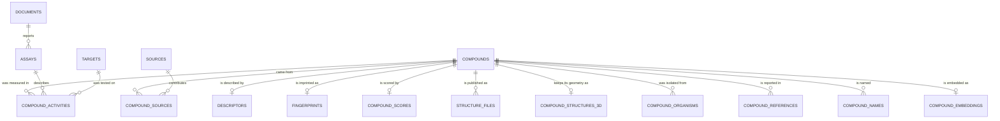

# Data model

[Repository home](../README.md) · [Docs index](README.md)

AURORA is a PostgreSQL database with the RDKit cartridge and the pgvector extension. This page describes
the public data model of release 2.0.0, which is in preparation and not published. The database itself is
not exposed: you reach it through the API or, once a package is published, through the release files.
This page names tables and public views and gives no row count; the figures are in the
[README](../README.md#at-a-glance), with their dates.

## Two areas

- **Complete.** Compounds with an approved 3D geometry, a docking file and the core feature tables. The
  API and the packages are meant to serve only these.
- **Incomplete.** Compounds with a full chemical identity and 2D features but no approved 3D geometry.
  They live in a separate schema, are marked, and are never mixed into the packages or the API.

Both areas share the dimension tables (sources, assays, targets, documents). A compound is in one area, and
the reading of 2026-11-16 found none in both.

## Main tables

| Group | Tables | What they hold |
|---|---|---|
| Identity and provenance | `compounds`, `sources`, `compound_sources`, `compound_records`, `alchemia_id_history` | One row per unique chemical identity with the public `alchemia_id`, structure, SMILES, InChI and marks; one row per source collection with its declared terms; which source contributed which compound, with the licence mark of the link; the form of the compound a source tested; the old-to-new map of the one renumbering of the ids |
| Geometry and files | `conformers`, `geometry_validity`, `structure_files`, `compound_structures_3d` | The approved 3D geometry and the checks it passed; SDF and PDBQT per compound, each with a SHA-256 |
| Protonation and tautomers | `protonation_variants`, `compound_tautomers` | The protonation states at pH 7.4 ± 1, one of them marked dominant; the grouping of tautomers, which never merges identities |
| Descriptors and fingerprints | `descriptors`, `fingerprints`, `compound_mhfp` | 1D, 2D and 3D descriptors; Morgan (two lengths), Atom-Pair, Topological-Torsion, MACCS and E3FP bit vectors; MHFP values |
| Predictions | `compound_scores`, `compound_np_likeness`, `compound_embeddings` | ADMET predictions and their applicability domain; natural-product likeness; one row per compound in the embeddings table, holding a 768-dimension learned vector (empty where the model refused the structure) |
| Classification and structure keys | `compound_chemical_classification`, `compound_np_classification`, `compound_scaffolds`, `compound_stereo_groups`, `compound_sugars` | Structural and natural-product classes; scaffolds; the groups that stereoisomers share; sugar counts |
| Names and cross-references | `compound_names`, `compound_xrefs`, `compound_xrefs_resolved`, `compound_organisms`, `compound_taxa`, `compound_references` | Names and synonyms; identifiers as the sources gave them and as resolved from the InChIKey (ChEBI, ChEMBL, PubChem CID); species of origin and taxa; bibliographic references |
| Bioactivity | `compound_activities`, `assays`, `targets`, `documents` | Bioactivity measurements about the compounds, each row with its own licence mark; the assay, the target and the document a measurement belongs to |
| Drug annotations | `compound_indications`, `compound_mechanisms`, `compound_drug_profile`, `compound_drug_classes` | Indications, mechanisms, approval and safety, and pharmacological classes, where the licence of the annotation allows |
| Ontology | `ontology_terms`, `ontology_relations` | The ChEBI ontology: structures, roles and classes |
| Collections | `collection_registry`, `collection_sources`, `compound_sets` | The collections of the platform, the rule that feeds each, and named versioned sets such as a diversity set |
| Release | `releases` | Which release is loaded |

Release 2.0.0 adds the bioactivity group and the ontology to what release 1.9.0 described; the schema also
holds tables for drug annotations, and this page does not say how many rows they hold. Bioactivity rows are marked as redistributable or not row by row. The platform switches that
serve them are off, and this page says nothing about when they will be on.

## Views

The views are the contract with any consumer. A consumer of the API or of the files meets these, not the
tables.

| View | What it is |
|---|---|
| `v_compound_catalog` | Every complete compound, one row each, with all of its marks; internal and complete |
| `v_open_cc_by_sa` | The complete compounds of the AURORA package, under CC BY-SA 4.0 |
| `v_open_cc_by_nc` | The complete compounds of the AURORA-NC package, under CC BY-NC 4.0: the ones that come only from sources with terms of their own |
| `v_distributable`, `v_distributable_nc` | The SDF and PDBQT file set of each package, with checksums |
| `v_open_cc_by_sa_activities` | The bioactivity rows of the AURORA package that may be served |
| `v_public_ids` | The public identifiers of each compound and the recorded status of each search |
| `v_collection_registry` | The collections of the platform, in list order |

## Search in SQL

The cartridge answers substructure (`mol @> qmol`) and Tanimoto similarity (`%` with a session threshold,
then `tanimoto_sml` to order). The fingerprint of a query must be generated the same way as the stored
column, or the score means nothing. These operators are reached through the API search routes, not through
direct SQL.

## Identifiers

`alchemia_id` has the form `ALC<n>`. It is append-only: a new compound takes a new number, and a number is
never reused. Release 2.0.0 renumbered the identifiers once, and the old-to-new map is kept in
`alchemia_id_history`, so an identifier written before release 2.0.0 may now name another compound. Internal
row keys never appear in the API.

Column-level documentation: [DATA_DICTIONARY.md](DATA_DICTIONARY.md).
