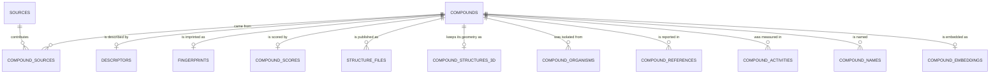

# Data model

[Repository home](../README.md) · [Docs index](README.md)

AURORA is a PostgreSQL database with the RDKit cartridge and the pgvector extension. This page describes
the public data model. The database itself is not exposed: you reach it through the API or through the
release files.

## Two areas

- **Complete.** Compounds with an approved 3D geometry, a docking file and the core feature tables. The
  API and the packages will serve only these.
- **Incomplete.** Compounds with a full chemical identity and 2D features but no approved 3D geometry.
  They live in a separate schema, are marked, and are never mixed into the packages or the API.

## Main tables

| Table | What it holds |
|---|---|
| `compounds` | One row per unique chemical identity: the public `alchemia_id`, structure, SMILES, InChI, marks |
| `sources` | One row per source collection, with its declared terms |
| `compound_sources` | Which source contributed which compound, with the licence mark of the link |
| `descriptors` | 1D and 2D descriptors, exhaustive 2D descriptors and 3D shape descriptors |
| `fingerprints` | Morgan (two lengths), Atom-Pair, Topological-Torsion, MACCS and E3FP |
| `compound_scores` | ADMET predictions and their applicability domain |
| `structure_files` and `compound_structures_3d` | SDF and PDBQT per compound, each with a SHA-256 |
| `compound_organisms`, `compound_references` | Species of origin with taxonomy, and bibliographic references |
| `compound_activities` | Bioactivity measurements |
| `compound_names`, `compound_embeddings` | Names and synonyms, and one 768-dimension learned vector per compound |
| `releases` | Which release is loaded |

## Views

The views are the contract with any consumer.

| View | What it is |
|---|---|
| Catalog view | Every complete compound, one row each, with all of its marks |
| AURORA package view | The complete compounds that may be redistributed under CC BY-SA 4.0 |
| AURORA-NC package view | The complete compounds that come only from sources with terms of their own, CC BY-NC 4.0 |
| Distributable file views | The SDF and PDBQT file set of each package, with checksums |
| Public identifiers view | The public identifiers of each compound and the recorded status of each search |

## Search in SQL

The cartridge answers substructure (`mol @> qmol`) and Tanimoto similarity (`%` with a session threshold,
then `tanimoto_sml` to order). The fingerprint of a query must be generated the same way as the stored
column, or the score means nothing. These operators are reached through the API search routes, not through
direct SQL.

## Identifiers

`alchemia_id` has the form `ALC<n>`. It is append-only: never reassigned, renumbered or reused. Internal
row keys never appear in the API.

Column-level documentation: [DATA_DICTIONARY.md](DATA_DICTIONARY.md).
